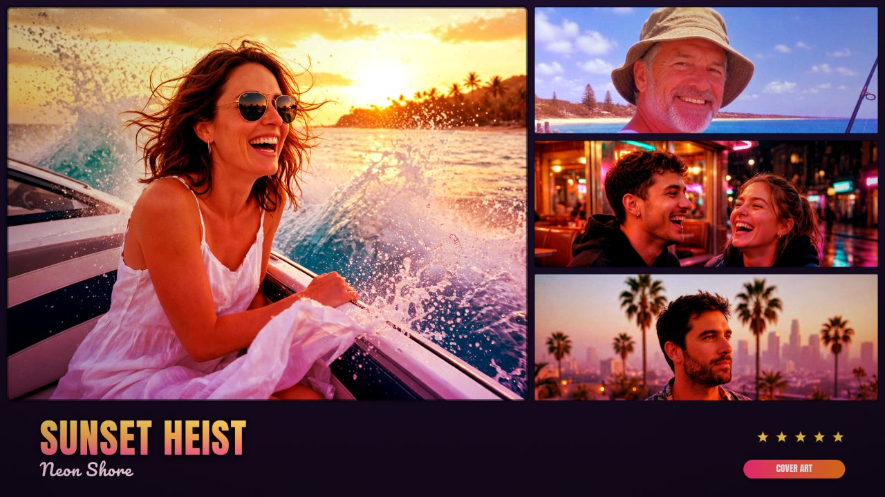

# Sunset Cover Studio — GTA-style cover art maker

[](https://make.fun/bounty/gta6-cover-art-01)
[](https://make.fun/bounty/gta6-cover-art-01/leaderboard)
[](https://make.fun/bounty/gta6-cover-art-01)

An entry for the [make.fun](https://make.fun) bounty
[gta6-cover-art-01](https://make.fun/bounty/gta6-cover-art-01): an offline web
app that turns any photo and a caption into GTA 6-style multi-panel cover art
and exports it as a PNG to share. Everything runs in the browser from static
files — no server, no upload, your photos never leave your machine.



## What it does

- **Six layouts** — Four Panel, Hero + Three, Full Bleed, Nine Panel (with a
  halftone title block in the centre), Tilted Snapshots (polaroid cards) and
  Poster.
- **Any photo** — upload one or more photos (file picker or drag & drop), or
  use the five built-in demo photos. Click a panel to select it, drag to move
  the photo inside it, scroll or use the slider to zoom. Fill several panels
  with one photo or several. Each photo's default crop keeps its subject in
  frame; the pan can never slide the photo off its panel.
- **Five colour grades** — Vice Sunset, Neon Night, Palm Gold, Teal Heat and
  Mono Noir, applied as canvas gradient maps over every panel.
- **Lettering** — a bold caption in Anton (white, sunset gradient or neon
  glow) plus a Pacifico script subtitle, both editable with a live preview.
- **Poster details** — a diagonal badge ribbon, a five-star heat meter, film
  grain and a vignette.
- **Exports** — PNG at 1080×1080, 1080×1350, 1920×1080 and 1080×1920 (story),
  one size at a time or all four at once. Undo and redo included.

## How it works

`app/` is a plain static site: `index.html` plus ES modules under `app/src/`
(no build step, no libraries, no network requests). The cover is drawn on a
2D canvas by `renderer.js`, which every layout, grade and effect shares, so
the live preview and the full-resolution export are the same drawing at two
sizes. Layouts are functions of the canvas size in `layouts.js`; grades are
filter-plus-gradient-map recipes in `grades.js`; `state.js` holds the editor
state and the undo/redo snapshots.

`main.ts` (Node 22, standard library only) hands the entry in: it copies
`app/` and `screenshots/` to `/output` and writes `/output/dossier.json`
with the vendored make.fun library.

Try it locally:

```sh
node serve.ts
# open http://localhost:8080
```

`?shot=cover` and `?shot=editor` stage fixed scenes for screenshots (see
`shots.json`): a cover full-frame, or the editor seeded with a sample photo
and caption. `window.__shotReady` is set once the scene has painted.

## Fonts and photos

- Lettering uses Anton and Pacifico, both under the SIL Open Font License
  (see `app/fonts/OFL.txt`), shipped as local files under `app/fonts/`.
- The five demo photos under `app/samples/` were made with an image model —
  two shipped with the competition kit, three made for this entry — and are
  free to use. All titles are invented; nothing here uses a
  Rockstar Games logo, artwork, character or font.

## Licence

MIT — see [LICENSE](LICENSE).
